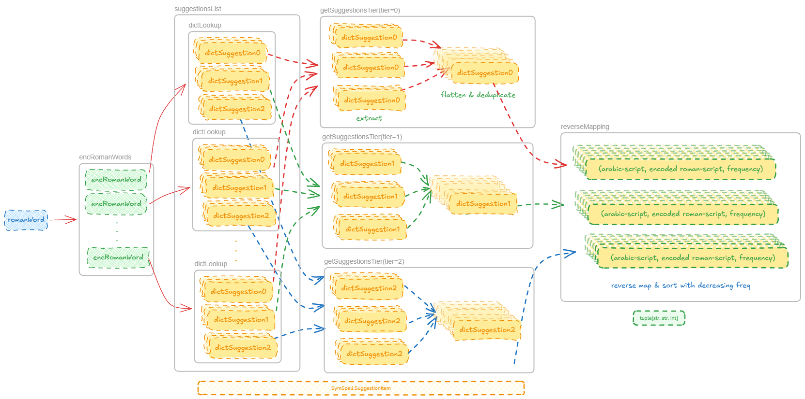

.. *****************************************************************************
   Copyright (c) 2026 RoXimn <roximn148@gmail.com>
   This source code is licensed under the MIT license found in the
   LICENSE.txt file in the root directory of this source tree.
   *****************************************************************************

********************************************************************************
RomanAlfaz Engine
********************************************************************************

Design
================================================================================
A vocabulary file supplies the arabic-script words and their frequencies.
:py:class:`~romanalfaz.engine.RomanAlfaz` reads each stored word, encodes it for
SymSpell, and returns the stored spelling in its results.

The engine normalizes a word as it builds the index. During
:py:meth:`~romanalfaz.engine.RomanAlfaz.recompileLookup`,
:py:func:`~romanalfaz.algorithm.tafseerUrduAr2Rm` runs the urdu-spell
normalization pipeline and then the Tafseer encoding rules. That produces the
roman key SymSpell stores. The engine keeps the word as written in the file and
returns that spelling in :py:attr:`~romanalfaz.engine.Suggestion.arabic`.

You maintain the arabic spellings in the vocabulary file. The engine does not
clean or rewrite them, and it does not choose a canonical spelling;
normalization supplies the lookup key, and the engine returns the stored word.
The engine fences malformed entries it cannot index:
:py:meth:`~romanalfaz.engine.Vocabulary.add` rejects a word whose normalized
form is empty, and
:py:meth:`~romanalfaz.engine.RomanAlfaz.recompileLookup` raises an
``AssertionError`` when a word contains characters outside the Arabic-to-Roman
map. The fence stops malformed data. Repair stays your job.

Cleaning belongs before the load. Two entries can share a roman key and have
different arabic spellings; the engine returns the spellings it read.

Run ``romanalfaz validate`` to find blank lines, malformed entries,
non-canonical spellings, unmapped characters, and duplicate canonical forms.
Run ``romanalfaz normalize`` to write one canonical spelling per word and sum
the frequencies of merged entries. Load the cleaned file, and the engine
returns those spellings as written.

.. code-block:: console

   $ romanalfaz validate words.sym
   $ romanalfaz normalize words.sym -o words.normalized.sym

.. code-block:: python

   from romanalfaz import RomanAlfaz
   from romanalfaz.engine import Vocabulary

   vocabulary = Vocabulary.load("words.normalized.sym")
   engine = RomanAlfaz(vocabularies=[vocabulary])

   engine.getBestMatch("kitab").arabic
   # 'کتاب', the spelling stored in words.normalized.sym

API
================================================================================
.. automodule:: romanalfaz.engine
   :members:
   :undoc-members:  # includes objects without docstrings
   :show-inheritance: # shows base classes

.. _romanalfaz-suggest-workflow:

   The internal workflow of the `RomanAlfaz.suggest`.

   (1) Encode the roman-script input. (2) Get a suggestions list
   from `SymSpell` for each encoding of the roman-script word. (3) Separate
   the *exact*, *one-edit* and *two-edit* suggestions. (4) Flatten the
   three suggestions tiers into a single list each and remove duplicates. (5) Add
   arabic-script word using reverse mapping from the encoded roman word. (6) Sort
   with decreasing word usage frequency. (7) Return the three tiers.

